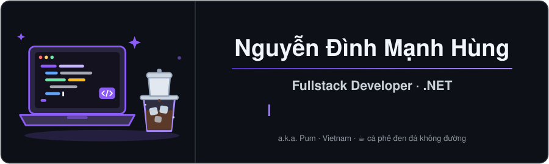
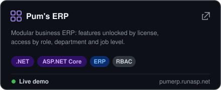
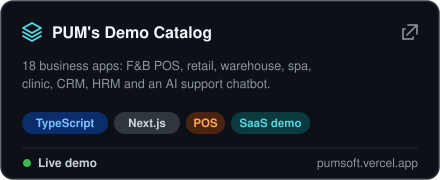
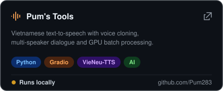
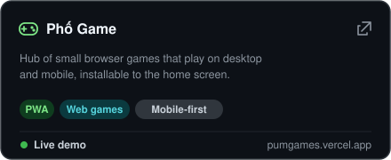

## Tech Stack

| Backend | Frontend | Cloud & Data | Tools |
| :---: | :---: | :---: | :---: |
|  |  |  |  |

## Featured Projects

<a href="https://github.com/Pum283?tab=repositories">View all repositories →</a>

  
  
  
  

## Focus

 

<picture>
  <source media="(prefers-color-scheme: dark)" srcset="dist/github-snake-dark.svg" />
  <source media="(prefers-color-scheme: light)" srcset="dist/github-snake.svg" />
  
</picture>
